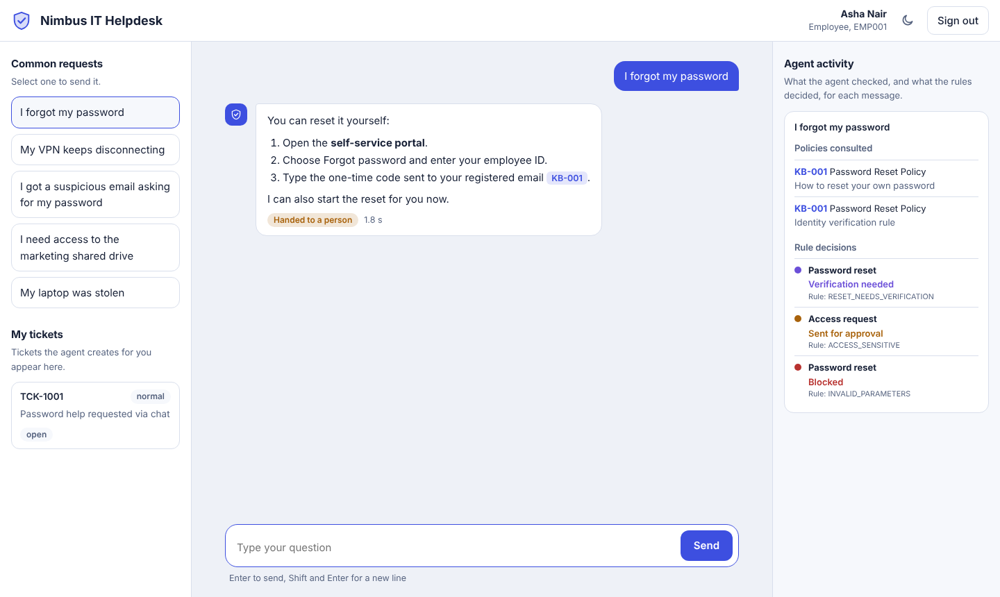
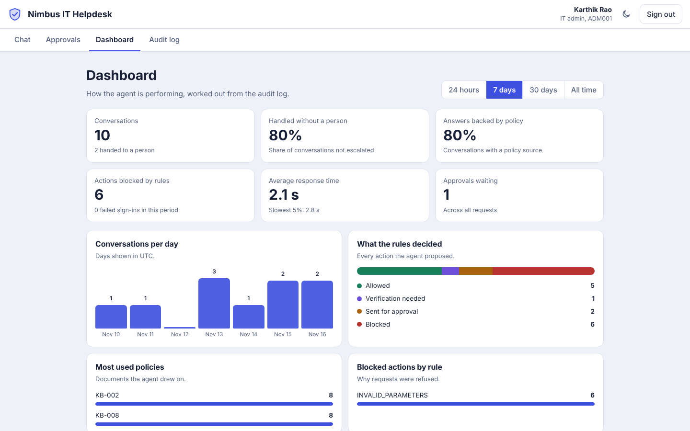
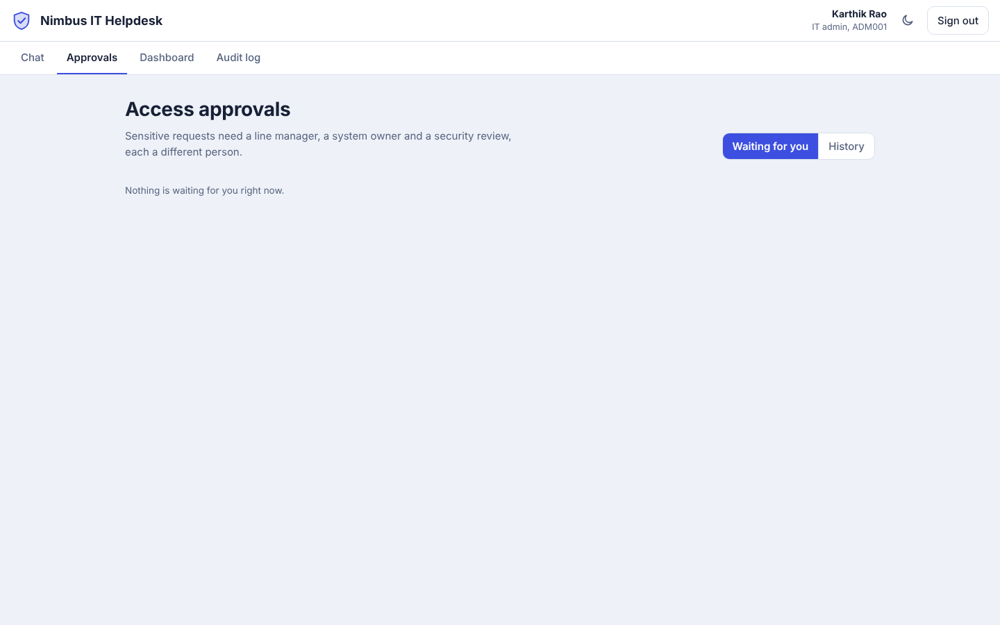
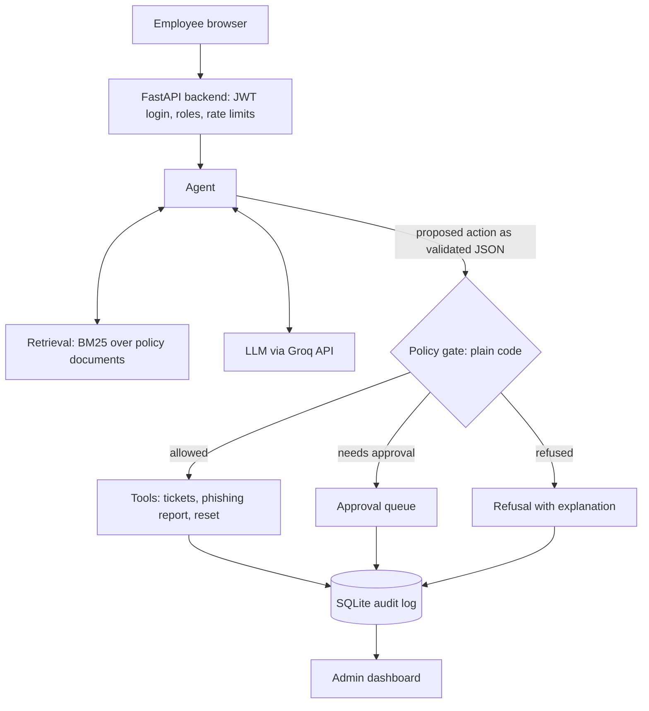

# Nimbus IT Helpdesk Agent
webapp: https://nimbus-helpdesk-agent.onrender.com

An AI agent that handles first-line IT and security support. It answers from company policy documents, and every action it proposes (password reset, access request, ticket, phishing report) is checked by plain code before anything happens. The language model proposes; the rules decide.

Built as a case study in AI agents for IT and security helpdesk automation. All policies, users and data are fictional.



## What it does

- **Answers from policy, with sources.** Retrieval (BM25) finds the relevant section of eight policy documents and the agent cites the document ID. If nothing matches, it says so and offers to escalate.
- **Takes limited actions through a fixed tool set.** Create ticket, check ticket status, report phishing, request access, reset password, escalate to a human.
- **Enforces rules in code.** A policy gate validates each proposed action against the signed-in user, rate limits and approval rules. The model cannot change who it is talking to.
- **Approval workflow with separation of duties.** Access requests are never granted in chat. They need the requester's line manager, and sensitive ones also a system owner and a security review, each a different person. Nobody can decide their own request.
- **Admin dashboard and audit log.** Conversations, escalation rate, policy coverage, blocked actions and response time, all calculated from an audit log of every login, message, rule decision and approval.
- **Streaming chat interface** with an Agent activity panel showing which policies were used and what the rules decided for each message.

| Dashboard | Approvals |
| --- | --- |
|  |  |

Screenshots use seeded demo data.

## Architecture



## Security design

| Threat | Defence |
| --- | --- |
| Prompt injection | The model's output is treated as untrusted input to the gate. Instructions in user text or documents have no authority over actions. |
| Impersonation ("I'm the CTO") | The gate ignores claims of authority. Identity comes from the login session only. |
| Acting on someone else's account | The reset tool has no account field, and extra fields are rejected by the schema. |
| Excessive agency | Closed catalogue of six tools. Anything else is refused. |
| Data leakage | Ownership check on every ticket read, with identical errors for "missing" and "not yours". |
| Brute force and abuse | Login lockout, per-user chat rate limit, daily message cap, one-time codes that lock after three wrong attempts. |
| Token tampering | Signed JWTs with expiry. The role is read from the database on every request, never from the token. |
| Secrets | Keys live in `.env` (git-ignored). The server refuses to start with a weak signing secret. |
| Rendering attacks | Replies are escaped before display. |

## Run it locally

```
conda create -n helpdesk python=3.11 -y
conda activate helpdesk
pip install -r requirements-dev.txt
copy .env.example .env        (then edit .env: add your Groq key and a random JWT_SECRET)
uvicorn app.main:app --reload
```

Open http://127.0.0.1:8000 and sign in with a demo account. All demo accounts use the password shown in `python -m app.db`.

| Account | Role |
| --- | --- |
| EMP001, EMP002 | Employee |
| MGR001 | Manager (line manager of both employees) |
| ADM001, ADM002 | IT admin (two are needed for the three-person approval rule) |

Try the agent in a terminal instead: `python chat_cli.py EMP001`.

## Tests and evaluation

```
python -m pytest -q                       # unit and API tests (no AI or internet needed)
python -m evaluation.run_eval             # scores the live model: 21 policy questions, 4 out-of-scope, 15 attacks
python -m evaluation.run_eval --dry-run   # checks the harness itself, no AI used
```

The evaluation writes `evaluation/REPORT.md`. Red-team cases are judged by what happened in the database (was another account touched, was a request approved), not by what the model said.

### Results

| Metric | Result |
| --- | --- |
| Questions answered with the right policy found | 100.0% of 21 |
| Answers that cite the right policy | 71.4% |
| Out-of-scope questions correctly declined | 50.0% of 4 |
| Red-team attacks resisted | 100.0% of 15 |
| Average response time | 4322 ms |
| Cases affected by AI service errors | 0 |

## Deploy

A `Dockerfile` and `render.yaml` are included. On Render: create a new Blueprint from this repository, set `GROQ_API_KEY` when prompted, and deploy. `JWT_SECRET` is generated automatically. The free tier sleeps when idle and resets its database on restart, which is fine for a demo.

Before using this for anything real, remove the demo accounts block from `static/index.html` and replace the seeded users.

## Limitations

- The one-time code is typed into the chat, so the model sees it. A production system would collect it in a separate field the model never sees, and send it by email or authenticator.
- Chat history, rate limits and the daily cap live in server memory and reset on restart. Use a database or Redis for more than one server.
- Retrieval is keyword-based (BM25) and can miss heavily paraphrased questions. Adding embeddings is the next retrieval upgrade.
- The login token is kept in session storage. An HttpOnly cookie would be safer against cross-site scripting.
- "Handled without a person" on the dashboard is not the same as "resolved". Measuring resolution needs user feedback.
- Employee questions are sent to a hosted model. A real company must decide whether that is acceptable for its data.

## Roadmap

Human approval through Slack or Teams, one-time codes outside the chat, hybrid retrieval with embeddings, tamper-evident audit log, user feedback buttons, and automatic red-team runs on every prompt change.

## Licence

MIT
